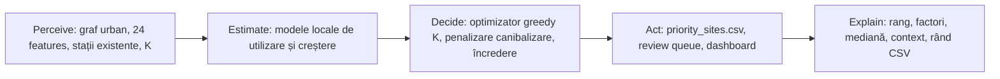

# PPC EV Siting Lab

**Agent de decizie pentru amplasarea stațiilor de încărcare EV pe un benchmark sintetic de orașe.**

Proiect pentru **24h to Power PPC – AI in energy, from data to action**. Domeniul vizat este **mobilitatea electrică și infrastructura de încărcare**, relevant pentru zona de e-mobility a PPC și pentru deciziile de investiții în rețeaua de stații.

PPC EV Siting Lab primește un oraș-graf, rulează două modele ML antrenate de echipă, alege un portofoliu de K stații și publică o listă prioritizată de amplasări, o coadă de verificare umană, un CSV executabil și un dashboard cu explicații. Fiecare recomandare poate fi urmărită până la predicția modelului și până la rândul CSV care a produs-o.

## 1. Problema și soluția

Un operator are un buget pentru **K stații noi** într-un oraș. Alegerea naivă este „unde e cea mai mare cerere”. Problema este că două stații apropiate își fură clienții reciproc: o parte din utilizarea stației noi este doar utilizare mutată de la o stație existentă.

De aceea, agentul optimizează **utilizarea totală a rețelei**, nu utilizarea izolată a fiecărei stații:

```text
beneficiu = utilizarea rețelei după adăugarea celor K stații
          − utilizarea rețelei înainte de cele K stații
```



| Etapă | Implementare | Dovezi |
|---|---|---|
| Perceive | Generator de orașe-graf, 24 de features observabile, stații existente, buget K | [generator.py](data-generation/src/evdata/generator.py), [build_data.py](frontend/tools/build_data.py) |
| Estimate | Două modele locale: utilizare și creștere incrementală; 3 seed-uri fiecare | [model.py](ML-Agent/src/evplacement/synthetic/model.py), [experiment.joblib](ML-Agent/outputs/synthetic/experiment.joblib) |
| Decide | Optimizator greedy K, penalizare de canibalizare, praguri de încredere și review | [model.py](ML-Agent/src/evplacement/synthetic/model.py), [agent.py](ML-Agent/src/evplacement/synthetic/agent.py) |
| Act | CSV cu 320 de acțiuni, coadă de 14 verificări, dashboard și export CSV | [priority_sites.csv](ML-Agent/outputs/synthetic/priority_sites.csv), [review_queue.csv](ML-Agent/outputs/synthetic/review_queue.csv), [frontend/](frontend/) |
| Explain | Fereastra „De ce acest nod?”: rang, comparație, factori, context, încredere, rând CSV | [app.js](frontend/app.js), [preview-why.png](frontend/preview-why.png) |

Agentul este un **flux determinist** care folosește predicțiile ML; nu depinde de un LLM și nu apelează un API extern de inferență. Acțiunile autonome sunt producerea listei prioritizate, marcarea cazurilor pentru review și generarea artefactelor. Decizia de a construi efectiv stația rămâne la operator.

## 2. Instalare reproductibilă

Mediul verificat: **Windows 11**, **Python 3.13.3**, NumPy **2.2.2**, pandas **3.1.1**, scikit-learn **1.6.1**, PyTorch **2.6.0**, NetworkX **3.4.2**. Pentru CUDA, instalați înainte wheel-ul PyTorch potrivit driverului; antrenarea funcționează și pe CPU, mai lent.

În PowerShell, dintr-un director în care doriți să clonați proiectul:

```powershell
git clone https://github.com/Mach3tryhard/Smiling-F-Smarthack-2026.git
cd Smiling-F-Smarthack-2026
cd ML-Agent
py -3.13 -m venv .venv
.\.venv\Scripts\python.exe -m pip install --upgrade pip
.\.venv\Scripts\python.exe -m pip install -r requirements.txt
.\.venv\Scripts\python.exe -m pip install -e . --no-deps
```

Interfața nu are dependențe npm și nu are build step. Bundle-ul demo este deja în `frontend/data/dashboard.json`; pentru demo nu trebuie să regenerați datasetul.

```powershell
cd ..\frontend
..\ML-Agent\.venv\Scripts\python.exe server.py
```

Aplicația: **http://127.0.0.1:8000/**. Serverul alege automat următorul port liber dacă 8000 este ocupat.

### Demo offline al agentului

```powershell
cd ML-Agent
.\.venv\Scripts\python.exe -m evplacement agent --k 8
```

Produce `priority_sites.csv` și `review_queue.csv` în `outputs/synthetic/`. Pentru demo-ul din interfață, bundle-ul este deja construit; `build_data.py` este necesar doar dacă modificați modelul, datele sau K.

### Reconstruirea completă a datelor și modelelor

```powershell
cd data-generation
python -m venv .venv
.\.venv\Scripts\python.exe -m pip install -e .
.\.venv\Scripts\python.exe -m evdata build

cd ..\ML-Agent
.\.venv\Scripts\python.exe -m evplacement build
.\.venv\Scripts\python.exe -m evplacement train --k 8
.\.venv\Scripts\python.exe -m evplacement agent --k 8
.\.venv\Scripts\python.exe -m evplacement report
```

Pentru a regenera bundle-ul UI, inclusiv K=1–12 și metricile pe K:

```powershell
cd ..\frontend
..\ML-Agent\.venv\Scripts\python.exe tools\build_data.py
```

`build_data.py` citește `cities.joblib` (261 MB), modelele antrenate și artefactele, apoi scrie `frontend/data/dashboard.json` (40 de orașe, 480 de acțiuni precalculate, metrici pentru K=1–12). Durează câteva minute.

## 3. Interfața pentru operator

- **Harta siturilor:** fundal alb intenționat, fără hartă geografică; noduri sintetice, stații existente, situri recomandate, halou proporțional cu creșterea estimată și marcaj pentru review. Click pentru detalii, dublu-click pentru trasabilitate.
- **Panoul de decizie:** rang, creștere estimată, utilizare estimată, dispersia ansamblului, scor de încredere, factori locali, context și rândul CSV exact.
- **Trasabilitatea deciziei:** „De ce acest nod?” arată rangul din K, comparația cu media siturilor selectate și cu următorul sit, impactul factorilor, contextul, încrederea și rândul CSV.
- **Clasament:** recomandările ordonate după creșterea estimată; filtre după încredere și review; click pe rând duce la nod.
- **K configurabil:** input numeric și butoane `−/+`, interval **1–12**. K=8 este benchmark-ul; K=1–8 taie din ordinea greedy; K=9–12 este extensie demo generată cu același model. Pentru K>8, rândul CSV este marcat indisponibil.
- **Date CSV:** exact `priority_sites.csv`, toate cele 16 coloane, search, click pe rând și descărcare.
- **Model:** R², Spearman, captură oracol, captură OOD, baseline-uri, importanța caracteristicilor și mozaicul celor 40 de orașe.

Notificările și acțiunile sunt locale, în aplicație. Nu există autentificare, roluri, audit multiutilizator sau integrare SCADA; este un demo local.

## 4. Date, surse și contracte

Datele sunt **100% sintetice**, generate de codul din repository. Nu folosim date private PPC, date personale sau telemetrie reală.

| Sursă | Utilizare | Proveniență |
|---|---|---|
| Generator propriu de orașe-graf | 400 de orașe, cerere latentă, stații, competiție Huff | [generator.py](data-generation/src/evdata/generator.py) |
| Benchmark sintetic | 300 train / 40 validation / 40 test / 20 OOD | [benchmark.json](data-generation/data/synthetic/benchmark.json) |
| Features observabile | 24 de caracteristici per nod | [build_data.py](frontend/tools/build_data.py) |
| Model ML propriu | Utilizare și creștere incrementală | [experiment.joblib](ML-Agent/outputs/synthetic/experiment.joblib) |

### Ce conține datasetul

- **400 de orașe** sintetice.
- **300** pentru antrenare, **40** pentru validare, **40** pentru test, **20** pentru test OOD.
- **501.812 noduri** și **36.809 stații existente**.
- **24 de features** per nod: cerere, accesibilitate, geometrie, land use, competiție și context urban.
- **320 de acțiuni** în benchmark-ul K=8: 8 situri × 40 de orașe.

Features-urile sunt împărțite în:

| Grup | Features |
|---|---|
| Cerere | `population`, `activity`, `income`, `ev_adoption`, `poi_density` |
| Accesibilitate | `centrality`, `road_capacity`, `transit_access`, `highway_access`, `parking` |
| Geometrie | `dist_center`, `degree`, `closeness` |
| Land use | `zone_business`, `zone_residential`, `zone_industrial` |
| Competiție | `competing_capacity`, `n_stations_1km`, `nearest_station_dist` |
| Context local | `local_population`, `local_activity` |
| Context de oraș | `planned_capacity`, `city_nodes`, `city_station_rate` |

Modelul **nu** primește `latent_demand`, `observed_usage` sau `is_station`. Splitul este pe orașe, nu pe rânduri; nicio informație din orașele de test nu ajunge la antrenare.

### Contractul `priority_sites.csv`

Fișierul are **16 coloane**:

```text
action_id, action, city_id, node_id, x, y, rank, predicted_uplift,
predicted_usage, uncertainty, confidence, confidence_score,
requires_human_review, review_reason, explanation, status
```

- `predicted_uplift`: creșterea incrementală estimată, în sesiuni/zi.
- `predicted_usage`: utilizarea estimată a stației, în sesiuni/zi.
- `uncertainty`: dispersia celor trei seed-uri.
- `confidence`: high / medium / low.
- `requires_human_review`: true pentru cele 14 cazuri.
- `review_reason`: motivul, în română.
- `explanation`: lista de feature-uri și drop-ul de occludare.
- `status`: `PROPOSED`.

Pentru K>8, recomandările suplimentare există doar în `dashboard.json` (`k_actions`), nu în CSV-ul original K=8.

## 5. Model ML propriu și evaluare

### Ce învață

| Model | Întrebare | Rânduri de antrenare | Rol |
|---|---|---|---|
| Modelul de utilizare | Câte sesiuni/zi are o stație existentă? | 27.324 stații | estimare, prag de review |
| Modelul de creștere | Câtă utilizare totală nouă aduce un candidat? | 350.187 candidați | clasarea siturilor |

Ambele modele folosesc aceeași arhitectură: un ansamblu de **trei MLP-uri** cu 24 de inputuri, straturi 256 → 128 → 64 și o ieșire. Predicția este media celor trei; dezacordul lor este semnalul de incertitudine.

Ținta modelului de creștere este:

```text
uplift_i = U(S ∪ {i}) − U(S)
```

unde `U` este utilizarea totală a portofoliului, calculată fără zgomot de simulator. Astfel, canibalizarea este inclusă în etichetă, nu doar în optimizator. Modelul de utilizare este antrenat pe `log1p(observed_usage)`, iar predicțiile sunt readuse cu `expm1`.

### Separarea datelor

| Set | Orașe | Folosit pentru |
|---|---:|---|
| Train | 300 | antrenarea modelelor |
| Validation | 40 | alegerea blend-ului și a lui `alpha` |
| Test | 40 | raportarea finală; orașe nevăzute |
| Test OOD | 20 | robustețe la parametri schimbați |

Testul este **pe orașe**, nu pe noduri. Este singura împărțire care răspunde la întrebarea „generalizează pe un oraș nou?”.

### Rezultate pe test

| Metrică | Valoare |
|---|---:|
| R² utilizare (log) | **0,871** |
| Spearman utilizare | **0,931** |
| MAE utilizare | 2,121 sesiuni/zi |
| R² creștere (log) | **0,735** |
| Spearman creștere | 0,801 |
| MAE creștere | 1,354 sesiuni/zi |
| Captură oracol K=8 | **85,5%** |
| Regret K=8 | **14,5%** |
| Suprapunere cu oracolul | 41,3% |
| Captură OOD | **88,4%** |
| Acțiuni / review | 320 / 14 |

### Baseline-uri

| Strategie | Captură din oracol |
|---|---:|
| Model + optimizator | **85,5%** |
| Populație | 11,3% |
| Aleator | 8,7% |
| Index manual | 7,5% |
| Activitate | 5,2% |

Baseline-urile sunt calculate pe aceleași 40 de orașe și cu același buget K. Baseline-ul cu populația este intuiția naivă pe care o are majoritatea publicului.

### Error analysis

Rezultatele nu sunt uniforme:

| Oraș | Captură | Regret |
|---|---:|---:|
| `test_204619` | **60,8%** | **39,2%** |
| `test_204615` | 70,7% | 29,3% |
| `test_204637` | 75,5% | 24,5% |
| `test_204614` | 76,9% | 23,1% |
| `test_204606` | 77,0% | 23,0% |
| `test_204628` | **98,8%** | **1,2%** |

- Creșterea este mai greu de prezis decât utilizarea: R² 0,735 vs 0,871.
- Optimizatorul este greedy, nu optim global; unele alegeri locale sunt cu 2–5% sub oracol.
- Fără penalizarea de canibalizare, captura scade la aproximativ 66,5%; cu `alpha=1.0` urcă la aproximativ 85,2% pe validare.
- Orașele OOD au captură 88,4%, dar R² scade; ranking-ul rămâne util, calibrarea absolută nu.
- 14 cazuri ajung la review: utilizare estimată sub 10 sesiuni/zi sau încredere medie/scăzută.

Detalii suplimentare: [`RAPORT_DETALIAT_RO.md`](ML-Agent/outputs/synthetic/RAPORT_DETALIAT_RO.md), [`metrics.json`](ML-Agent/outputs/synthetic/metrics.json), [`placement_results.csv`](ML-Agent/outputs/synthetic/placement_results.csv).

### Ce nu folosim

- Fără LLM și fără API extern de ML în inferență.
- Fără features care ar conține adevărul: cerere latentă, utilizare observată, flag de stație.
- Fără split aleatoriu pe rânduri; splitul este pe orașe.
- Fără model de cost, venit, permisare sau capacitate reală de rețea.

## 6. Agentul: K, praguri și constrângeri

Pentru fiecare oraș, agentul calculează predicțiile pentru toți candidații, apoi alege K situri unul câte unul:

```text
score_i = predicted_uplift_i / (1 + alpha · Σ_j exp(−distance_ij / lambda))
```

- `alpha = 1.0`, ales pe validare.
- Penalizarea descurajează plasarea următoarei stații lângă una deja selectată.
- Se oprește la K; K=8 este benchmark-ul, K=1–12 este disponibil în interfață.

| Situație | Acțiune |
|---|---|
| Încredere high (scor ≥ 70) și utilizare estimată ≥ 10 sesiuni/zi | `PROPOSED`, fără review |
| Încredere medium (45–70) | `PROPOSED`, review |
| Încredere low (< 45) | `PROPOSED`, review |
| Utilizare estimată < 10 sesiuni/zi | `PROPOSED`, review |
| K în afara 1–12 | clamp la intervalul valid |

Pragurile sunt **euristici de prototip**, nu praguri aprobate de PPC. Încrederea este derivată din dezacordul celor trei seed-uri, nu este o probabilitate calibrată.

### Acțiuni produse

- `priority_sites.csv` — 320 de acțiuni K=8, cu explicații și review.
- `review_queue.csv` — cele 14 cazuri care necesită om.
- `dashboard.json` — 40 de orașe, K=1–12, acțiuni și metrici.
- Interfața — listă prioritizată, hartă, clasament, explicații, CSV.

### De ce este agent, nu doar model

Agentul percepe datele, estimează cu modelele, decide sub constrângeri (K, canibalizare, încredere), acționează prin artefacte și își explică decizia. Fiecare recomandare este trasabilă: **intrare → predicție → rang → factori → review → rând CSV**.

## 7. Robustness, responsabilitate și securitate

- **OOD:** 20 de orașe cu parametri schimbați; captură 88,4%.
- **Incertitudine:** dezacordul celor trei seed-uri; cazurile medii/scăzute merg la review.
- **Cazuri rare / business case slab:** prag de 10 sesiuni/zi; 14 cazuri.
- **Input invalid:** K este limitat la 1–12; fișierele lipsă sau JSON-ul invalid produc un mesaj de eroare, nu o decizie.
- **Date lipsă:** datele sintetice sunt complete prin construcție; **nu avem încă un imputer** pentru valori lipsă reale. Este o limitare explicită înainte de un pilot.
- **Fără PII / fără SCADA:** nu există date de clienți, acreditări sau telemetrie PPC.
- **Local:** server static, fără autentificare, fără write API, fără audit multiutilizator. Este un demo, nu un sistem de producție.
- **Artefact model:** `joblib` trebuie încărcat doar din surse de încredere.

## 8. Teste, dovezi și rubrică

Material de prezentare: [`docs/PPC_EV_Siting_Lab_5min.pptx`](docs/PPC_EV_Siting_Lab_5min.pptx) — 8 slide-uri + 2 anexe, cu note de prezentator.

```powershell
cd frontend
..\ML-Agent\.venv\Scripts\python.exe tools\ui_check.py
```

Verificarea UI rulează cu serverul pornit și acoperă: zoom, filtre, sincronizarea hartă–listă–panou, dublu-click pentru trasabilitate, valorile driverilor, K=3/K=12, rândurile din clasament și tipografia rangurilor. În ultima rulare: **toate verificările au trecut**.

| Criteriu hackathon | Dovadă în proiect |
|---|---|
| **Idea & Relevance · 25p** | Problemă de amplasare EV sub buget, cu canibalizare; secțiunile 1 și 8 |
| **ML Quality · 25p** | Două modele locale, split pe orașe, baseline-uri, metrici, error analysis; secțiunea 5 |
| **The Agent · 25p** | Flux automat date → ML → K → CSV/review/dashboard; secțiunile 1 și 6 |
| **Robustness · 10p** | OOD, incertitudine, review, limite explicite; secțiunea 7 |
| **Explainability · 10p** | „De ce acest nod?” + factori + mediană + rând CSV |
| **Demo & Repository · 5p** | README, PPT de 5 minute, verificări UI, artefacte și comenzi |

**Cerințe eliminatorii:** model antrenat de echipă, cod de antrenare în repository, test separat și baseline, inferență fără API extern de ML, acțiuni automate dincolo de chat, date publice/sintetice cu surse. Tabelul documentează dovezi, nu garantează punctajul juriului.

### Demo de 5 minute

1. **0:00–0:35:** problema și de ce „unde e multă lume” nu este suficient.
2. **0:35–1:25:** harta, haloul, stațiile existente și controlul K.
3. **1:25–2:25:** click pe situl de rang 1 și fereastra „De ce acest nod?”.
4. **2:25–3:10:** schimbă K=8 → K=3/K=12; arată cum se schimbă lista, clasamentul și captura.
5. **3:10–4:10:** CSV-ul exact, baseline-urile și modelul.
6. **4:10–5:00:** limitele, onestitatea și următorii pași.

Pentru Q&A: de ce sintetic, de ce două modele, de ce K=8, de ce 85,5% și nu 100%, de ce 41,3% suprapunere, ce lipsește pentru producție.

## 9. Structura repository-ului și următorii pași

```text
Smiling-F-Smarthack-2026/
  README.md                  Acest document
  docs/
    PPC_EV_Siting_Lab_5min.pptx   Prezentarea de 5 minute
    assets/                  Capturi folosite în PPT
  frontend/
    index.html               Interfața în română
    app.js                   Harta, K, explicații, clasament, CSV, model
    styles.css               Tema vizuală
    data/                    Bundle-ul UI și CSV-urile copiate
    tools/build_data.py      Artefacte → dashboard.json (K=1–12)
    tools/ui_check.py        Verificări Playwright
  ML-Agent/
    src/evplacement/         Model, agent, optimizator, CLI
    outputs/synthetic/       Modele, metrici, CSV-uri, rapoarte
  data-generation/
    src/evdata/              Generatorul de orașe și benchmark
```

**Următorii pași:**

1. Calibrare pe date reale de utilizare și pe stații existente.
2. Adăugarea costurilor, capacității de rețea și permisării.
3. Imputer și validare pentru date lipsă/nedumerice.
4. Pilot pe un oraș, cu review uman și metrici operaționale.
5. Extinderea explicațiilor către factori de politică publică și echitate.

**Repository:** [`Mach3tryhard/Smiling-F-Smarthack-2026`](https://github.com/Mach3tryhard/Smiling-F-Smarthack-2026) — trebuie să fie public la predare.
