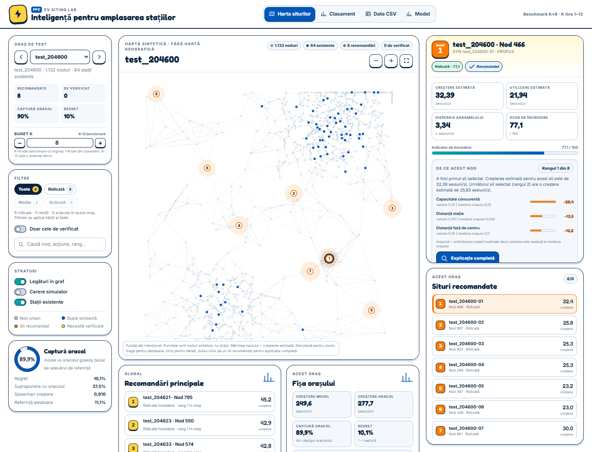
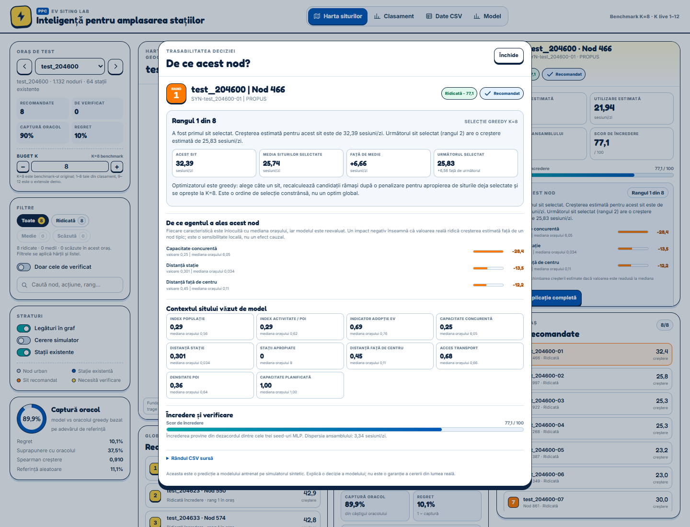

# PPC EV Siting Lab — README complet

> **Un singur README pentru tot proiectul.**
> Aici găsești problema, datele, agentul, interfața, controlul K, rezultatele, comenzile de rulare și un ghid de prezentare pentru public fără background de machine learning.

> **Proiectul pe scurt:** un agent care primește un oraș sintetic și un buget de **K stații de încărcare** — implicit **K=8**, configurabil în interfață între **1 și 12** — și recomandă unde să fie puse. Nu prezice venit real pentru București. Rezolvă un benchmark controlat, în care știm adevărul pentru fiecare amplasare posibilă.





## Ce conține proiectul

| Componentă | Rol |
|---|---|
| [`frontend/`](frontend/) | Interfața în română: hartă albă, clasament, CSV, model, control K, explicații |
| [`ML-Agent/`](ML-Agent/) | Generarea benchmark-ului, modelele, optimizatorul, evaluarea, artefactele |
| [`data-generation/`](data-generation/) | Generatorul de orașe sintetice și benchmark-ul |
| [`docs/`](docs/) | Prezentarea PowerPoint de 5 minute și materiale de susținere |
| [`ML-Agent/outputs/synthetic/`](ML-Agent/outputs/synthetic/) | Modele, predicții, CSV-uri, rapoarte, dashboard |
| [`README.md`](README.md) | Acest document — singurul README al proiectului |

## Pornire rapidă

```powershell
cd frontend
..\ML-Agent\.venv\Scripts\python.exe server.py
```

Se deschide `http://127.0.0.1:8000/`.

Pentru reconstruirea bundle-ului UI, inclusiv K=1–12 și metricile pe K:

```powershell
cd frontend
..\ML-Agent\.venv\Scripts\python.exe tools\build_data.py
```

### Pipeline complet

Generatorul de date:

```powershell
cd data-generation
python -m venv .venv
.\.venv\Scripts\python.exe -m pip install -e .
.\.venv\Scripts\python.exe -m evdata build
```

Modelele, benchmark-ul și acțiunile agentului:

```powershell
cd ML-Agent
.\.venv\Scripts\python.exe -m pip install -r requirements.txt
.\.venv\Scripts\python.exe -m pip install -e . --no-deps
.\.venv\Scripts\python.exe -m evplacement build
.\.venv\Scripts\python.exe -m evplacement train --k 8
.\.venv\Scripts\python.exe -m evplacement agent --k 8
.\.venv\Scripts\python.exe -m evplacement report
```

Interfața:

```powershell
cd frontend
..\ML-Agent\.venv\Scripts\python.exe server.py
```

## Cuprins

1. [Povestea în 60 de secunde](#1-povestea-în-60-de-secunde)
2. [Problema de decizie](#2-problema-de-decizie)
3. [De ce date sintetice](#3-de-ce-date-sintetice)
4. [Cum este construit agentul](#4-cum-este-construit-agentul)
5. [Ce înseamnă fiecare cifră](#5-ce-înseamnă-fiecare-cifră)
6. [De ce nu este noroc](#6-de-ce-nu-este-noroc)
7. [Turul interfeței](#7-turul-interfeței)
8. [K configurabil în interfață](#k-configurabil-în-interfață)
9. [Prezentarea PowerPoint de 5 minute](#prezentarea-powerpoint-de-5-minute)
10. [Scenariu de prezentare de 8–10 minute](#8-scenariu-de-prezentare-de-810-minute)
11. [Varianta de 3 minute](#9-varianta-de-3-minute)
12. [Întrebări probabile și răspunsuri](#10-întrebări-probabile-și-răspunsuri)
13. [Glosar pentru public ne-tehnic](#11-glosar-pentru-public-ne-tehnic)
14. [Limitări și onestitate](#12-limitări-și-onestitate)
15. [Cum rulezi proiectul](#13-cum-rulezi-proiectul)
16. [Checklist înainte de prezentare](#14-checklist-înainte-de-prezentare)

---

## 1. Povestea în 60 de secunde

Imaginează-ți că ești responsabil de o rețea de stații de încărcare pentru mașini electrice. Ai un buget pentru **opt stații noi** într-un oraș. Unde le pui?

Răspunsul naiv este: „unde e cea mai mare cerere”. Problema este că două stații puse una lângă alta își fură clienții reciproc. Dacă adaugi o stație într-o zonă deja deservită, o parte din utilizarea ei este doar utilizare mutată de la stația vecină. Beneficiul real pentru sistem este mai mic decât pare.

Proiectul nostru face trei lucruri:

1. **Construiește un oraș simulat** în care știm cererea ascunsă și putem calcula exact ce se întâmplă dacă adăugăm o stație oriunde.
2. **Antrenează un model** care învață din 300 de orașe simulate să estimeze câtă utilizare nouă ar crea fiecare amplasare.
3. **Alege opt situri** cu un optimizator care ține cont și de canibalizare, apoi le arată într-o interfață în care fiecare recomandare poate fi explicată.

Rezultatul pe 40 de orașe de test, niciodată văzute la antrenare: modelul capturează **85,5%** din beneficiul pe care l-ar obține un „oracol” care cunoaște adevărul complet. Un baseline aleator capturează aproximativ **8,7%**.

> **Propoziția de lift pentru prezentare:**
> „Nu punem stații unde e multă lume. Punem stații unde utilizarea nouă este mare și nu este furată de stațiile vecine.”

---

## 2. Problema de decizie

### 2.1 Ce primește agentul

Agentul primește un oraș reprezentat ca un **graf**:

- fiecare punct este un nod (o locație posibilă);
- liniile dintre noduri sunt legături de vecinătate;
- unele noduri au deja o stație de încărcare;
- fiecare nod are caracteristici observabile: populație, activitate, acces la transport, capacitate rutieră, competiție, etc.;
- agentul are un buget de **K stații noi** (implicit 8; configurabil în interfață între 1 și 12);

Trebuie să aleagă 8 noduri fără stație, astfel încât să crească utilizarea totală a rețelei.

### 2.2 De ce „unde e cererea mare” nu este suficient

Să presupunem că două noduri sunt foarte apropiate și ambele au cerere mare. Dacă pui stații în ambele, a doua nu mai aduce opt stații noi de cerere: o parte din clienții ei ar fi mers oricum la prima. Acest efect se numește **canibalizare**.

De aceea avem nevoie de două lucruri diferite:

- o predicție a utilizării pe care ar avea-o o stație;
- o predicție a **creșterii incrementale** pentru sistem, după ce scădem canibalizarea.

A doua este cea care contează pentru decizie.

### 2.3 Ce înseamnă K

K este bugetul. Nu putem alege 20 de situri și apoi să spunem „uite ce bine ar fi”. Trebuie să alegem exact K, ca într-o decizie reală cu bani limitați. Benchmark-ul original folosește **K=8**; interfața permite și K=1–12, cu metrici recalculate.

### 2.4 Ce optimizăm

Optimizăm **utilizarea totală a sistemului**, nu utilizarea fiecărei stații în parte.

Cu alte cuvinte:

```text
beneficiu = utilizarea rețelei după ce adăugăm cele 8 stații
          − utilizarea rețelei înainte de cele 8 stații
```

Dacă o stație nouă are 30 de sesiuni pe zi, dar 10 dintre ele sunt luate de la stații existente, beneficiul incremental este 20, nu 30.

---

## 3. De ce date sintetice

### 3.1 Problema datelor reale

Datele reale despre stații de încărcare ne spun:

- unde sunt stațiile;
- cât au fost folosite.

Nu ne spun însă **ce s-ar fi întâmplat dacă stația ar fi fost în altă parte**. Acesta este un fapt contrafactual: nu poate fi observat direct. În plus, stațiile existente nu au fost amplasate aleatoriu; operatorii le-au pus deja în locuri în care se așteptau la cerere. Dacă antrenăm un model pe aceste date, el învață și prejudecata selecției.

Fără contrafactuale nu putem răspunde corect la întrebarea „ar fi fost o amplasare mai bună decât alta?”. Putem evalua dacă modelul prezice bine stațiile existente, dar nu putem evalua regretul unei amplasări noi.

### 3.2 Soluția: un simulator

Simulatorul construiește orașe de la zero:

- desenează o rețea urbană cu 2–8 centre, coridoare și zone periferice;
- atribuie fiecărui nod o **cerere latentă ascunsă**;
- plasează stații existente cu capacități diferite;
- generează utilizarea stațiilor printr-un model de competiție spațială de tip **Huff**;
- poate rula din nou orașul cu orice combinație de stații, inclusiv una care nu a existat niciodată.

Astfel obținem două lucruri pe care datele reale nu le oferă:

- **uplift-ul unui candidat**: câtă utilizare totală nouă apare dacă adăugăm o stație exact acolo;
- **valoarea unei întregi portofolii**: câtă utilizare totală apare dacă adăugăm toate cele 8 stații alese.

Simulatorul este profesorul care știe răspunsul corect. Modelul este elevul care trebuie să învețe să ajungă la un răspuns bun fără să vadă răspunsul la examen.

### 3.3 Ce este competiția Huff

Huff este un model simplu de împărțire a cererii între mai multe destinații. Fiecare stație are o atractivitate (capacitate, proximitate), iar un client alege stația cu atractivitatea relativă cea mai mare. Cu cât o stație este mai aproape și mai mare, cu atât atrage mai mult.

Nu trebuie să prezinți formula. Este suficient să spui:

> „Simulatorul modelează competiția dintre stații: dacă pui o stație nouă lângă una veche, o parte din cerere se mută, nu se creează.”

### 3.4 Ce vede modelul și ce vede simulatorul

Aceasta este o separare importantă:

| Simulatorul știe | Modelul vede |
|---|---|
| cererea latentă adevărată | caracteristici observabile |
| utilizarea realizată a stațiilor | caracteristici de populație, activitate, acces |
| efectul unei stații care nu există | competiția existentă, nu viitoarele alegeri |
| răspunsul corect pentru fiecare portofoliu | doar caracteristicile de dinaintea construcției |

Modelul **nu** primește `latent_demand`, `observed_usage` sau `is_station`. Altfel ar „trișa”: ar vedea răspunsul la examen.

### 3.5 Cifrele datasetului

- **400 de orașe sintetice** în total.
- **300** pentru antrenare.
- **40** pentru validare.
- **40** pentru test.
- **20** pentru test OOD (out-of-distribution), cu parametri schimbați.
- **501.812 noduri**.
- **36.809 stații existente**.
- **24 de caracteristici** pentru fiecare nod.
- **320 de acțiuni** finale: 8 situri × 40 de orașe de test.
- **14 acțiuni** marcate pentru verificare umană.

---

## 4. Cum este construit agentul

### 4.1 Diagrama simplă

```text
Orașe sintetice
      │
      ▼
Simulator Huff ──► adevărul de referință (ce s-ar întâmpla)
      │
      ├──► model de utilizare  ──► câte sesiuni/zi ar avea o stație
      │
      └──► model de creștere   ──► câtă utilizare nouă aduce un candidat
                                      │
                                      ▼
                         optimizator greedy K configurabil
                         + penalizare pentru canibalizare
                                      │
                                      ▼
                         8 situri recomandate
                                      │
                                      ▼
                        interfață + explicații + CSV
```

„Agentul” nu este un chatbot și nu este un LLM. Este un **pipeline de decizie** format din două modele antrenate, un optimizator și o componentă de verificare.

### 4.2 Două modele, două întrebări

| Model | Întrebare | Date de antrenare | Rol |
|---|---|---|---|
| Modelul de utilizare | Câte sesiuni/zi va avea o stație existentă? | 27.324 stații | estimare, prag de verificare |
| Modelul de creștere | Câtă utilizare totală nouă aduce un candidat? | 350.187 candidați | clasarea siturilor |

De ce două modele?

- O stație existentă are deja un istoric de utilizare.
- Un nod candidat nu are stație, deci nu are utilizare observată.
- Decizia este despre **diferența** pe care o aduce stația, nu despre utilizarea ei izolată.

Modelul de creștere este cel care răspunde la întrebarea „merită să pun aici?”. Modelul de utilizare ajută la explicarea valorii absolute și la regula de verificare: dacă utilizarea estimată este sub 10 sesiuni/zi, cazul este trimis la verificare umană.

### 4.3 Cum învață modelul

Fiecare model este o rețea neuronală mică de tip **MLP**:

```text
24 caracteristici
   → 256 neuroni
   → 128 neuroni
   → 64 neuroni
   → 1 valoare prezisă
```

Se antrenează **trei astfel de rețele**, cu seed-uri diferite. Predicția finală este media lor. Dezacordul dintre cele trei este folosit ca semnal de incertitudine.

Antrenarea este pe **logaritmul** valorii, nu pe valoarea brută. De ce? Pentru că utilizarea are o coadă lungă: majoritatea stațiilor au puține sesiuni, câteva au foarte multe. Logaritmul comprimă coada și face învățarea mai stabilă. Predicțiile sunt transformate înapoi în sesiuni/zi.

Modelul nu vede orașul ca pe o imagine și nu folosește un LLM. Vede un tabel cu 24 de caracteristici pentru fiecare nod.

### 4.4 Ce învață de fapt

Ținta pentru modelul de creștere este:

```text
creștere = utilizarea totală după adăugarea stației
         − utilizarea totală înainte de adăugarea stației
```

Această formulă include deja canibalizarea. O stație cu utilizare individuală mare, dar care fură mult de la vecini, are o creștere mică și nu va fi aleasă.

### 4.5 Optimizatorul greedy

Modelul prezice o creștere pentru fiecare candidat. Naiv ar fi să alegem primii 8 candidați după valoare. Problema: se pot grupa toți în același cartier.

Optimizatorul adaugă situri **unul câte unul**:

1. calculează scorul fiecărui candidat;
2. aplică o penalizare pentru apropierea de siturile deja alese;
3. alege candidatul cu cel mai bun scor;
4. repetă până la 8 situri.

Penalizarea este controlată de un parametru `alpha`. Pe validare, `alpha=1.0` a fost cea mai bună alegere. Fără penalizare, captura din oracol era aproximativ **66,5%**; cu penalizare, aproximativ **85,2%** pe validare. Aceasta este dovada că canibalizarea nu este un detaliu cosmetic.

### 4.6 Ce este oracolul

Oracolul este un algoritm care are acces la adevărul simulatorului. Alege și el greedy, dar folosind valoarea reală, nu predicția. Este un profesor cu răspunsul la îndemână.

Oracolul **nu este optimul global**. A alege cele mai bune 8 din aproximativ 1.000 de candidați este o problemă combinatorică uriașă. Oracolul greedy este o referință puternică și transparentă, nu o dovadă că nu există o soluție și mai bună.

### 4.7 De ce 85,5% este un rezultat bun

Dacă modelul ar fi perfect, ar lua 100% din valoarea oracolului. În practică:

- modelul este antrenat pe date sintetice, cu zgomot;
- prezice creșterea, care este o diferență între două simulări;
- optimizatorul este greedy, nu global;
- unele situri diferite au valoare aproape egală.

**85,5%** înseamnă că, din beneficiul suplimentar pe care l-ar crea oracolul, modelul capturează 85,5%. Regretul este de aproximativ **14,5%**.

### 4.8 Încrederea și coada de verificare

Fiecare recomandare are:

- un nivel de încredere: **Ridicată / Medie / Scăzută**;
- un scor 0–100;
- o dispersie a ansamblului: cât de mult diferă cele trei rețele;
- un motiv de verificare, dacă este cazul.

Încrederea nu este o probabilitate calibrată. Este un semnal de triaj: „cât de sigur este ansamblul pe acest nod?”. Dacă modelele nu sunt de acord, omul trebuie să se uite mai atent.

Cele **14** cazuri din coada de verificare sunt exact cele în care utilizarea estimată este sub 10 sesiuni/zi sau încrederea este medie. Nu sunt ascunse; interfața le arată explicit.

---

## 5. Ce înseamnă fiecare cifră

### 5.1 Tabelul scurt

| Indicator | Valoare | Ce înseamnă |
|---|---:|---|
| R² utilizare (log) | **0,871** | modelul explică 87,1% din variația log-utilizării |
| Spearman utilizare | **0,931** | ordinea stațiilor este foarte bine prezisă |
| R² creștere (log) | **0,735** | creșterea este mai greu de prezis decât utilizarea |
| Captură oracol | **85,5%** | din beneficiul oracolului, pe 40 de orașe de test |
| Regret | **14,5%** | diferența până la oracol |
| Captură OOD | **88,4%** | pe 20 de orașe cu parametri schimbați |
| Suprapunere cu oracolul | **41,3%** | cât de des alege exact aceleași noduri |
| Acțiuni / verificări | **320 / 14** | 8 situri × 40 de orașe; 14 de verificat |

### 5.2 R² nu este „acuratețe”

R² aproape de 1 înseamnă că modelul explică o parte mare din variație. Nu înseamnă că 87,1% din predicții sunt „corecte” în sens de clasificare. Aici nu avem etichete de tip „corect/greșit”; avem valori continue.

### 5.3 De ce R² la creștere este mai mic

Utilizarea unei stații existente este o cantitate măsurabilă, cu un semnal relativ stabil. Creșterea este o **diferență** între două scenarii simulate: două cantități mari se scad și rezultatul este mai mic și mai zgomotos. Este normal ca R² la creștere să fie mai mic decât la utilizare.

### 5.4 De ce suprapunerea cu oracolul este doar 41,3%

Pentru că mai multe situri pot fi aproape la fel de bune. Dacă oracolul alege nodul A și modelul alege nodul B, aflat la 100 de metri, pierderea de utilitate poate fi mică. Suprapunerea exactă pedepsește prea dur o decizie bună. De aceea metrica principală este **captura de utilitate**, nu potrivirea exactă a nodurilor.

### 5.5 Baseline-urile

| Strategie | Captură din oracol |
|---|---:|
| Model + optimizator | **85,5%** |
| Populație | 11,3% |
| Index manual | 7,5% |
| Aleator | 8,7% |
| Activitate | 5,2% |

Un baseline „pune stații unde e populație” ia doar 11,3%. Modelul nu este cu câteva procente mai bun; este de aproape opt ori mai bun la captura de utilitate.

### 5.6 Ce ne spune importanța caracteristicilor

Cele mai importante caracteristici pentru modelul de creștere sunt:

1. capacitatea concurentă din apropiere;
2. distanța față de centru;
3. numărul de stații în vecinătate;
4. populația;
5. distanța până la cea mai apropiată stație.

Concluzia pentru public:

> „Modelul a învățat că **competiția** contează cel puțin la fel de mult ca cererea brută. Asta este exact intuiția pe care am vrut să o surprindem.”

---

## 6. De ce nu este noroc

Aceasta este întrebarea care poate decide dacă proiectul pare serios sau pare o demonstrație aranjată. Răspunsul are patru părți.

### 6.1 Orașele de test sunt complet separate

Modelul este antrenat pe 300 de orașe, validat pe 40 și testat pe 40 de orașe cu seed-uri diferite. Niciun nod din orașele de test nu apare la antrenare. Nu este o împărțire aleatorie de rânduri, care ar putea scăpa informație spatială; este o împărțire pe orașe.

### 6.2 Modelul nu primește adevărul

`latent_demand`, `observed_usage` și `is_station` sunt interzise ca inputuri. Modelul vede doar caracteristici pe care un operator le-ar putea cunoaște înainte de construcție.

### 6.3 Baseline-urile sunt reale, nu paie

Populația, activitatea, indexul manual și aleatorul sunt calculate pe aceleași orașe și cu același buget K=8. Modelul le bate pe toate. Baseline-ul „populație” este exact intuiția naivă pe care o are majoritatea publicului.

### 6.4 Ablația arată contribuția optimizatorului

Fără penalizarea de canibalizare, captura scade de la aproximativ 85% la aproximativ 66%. Aceasta arată că rezultatul nu vine doar din model, ci și din modul în care sunt combinate siturile.

### 6.5 Ce nu dovedește

Nu dovedește că modelul va funcționa pe București real. Nu dovedește că 85,5% se va păstra pe date reale. Dovedește că, pe un benchmark controlat, pipeline-ul generalizează la orașe noi și învinge baseline-uri simple.

---

## 7. Turul interfeței

Interfața este în română și are patru secțiuni.

### 7.1 Harta siturilor

- fundal alb, fără hartă geografică;
- puncte gri mici = noduri urbane sintetice;
- puncte albastre = stații existente;
- puncte portocalii cu numere = situri recomandate;
- haloul portocaliu este proporțional cu creșterea estimată;
- un punct galben/portocaliu poate însemna „necesită verificare”;
- tooltip la hover: rang, creștere, încredere, factor principal;
- click = detalii;
- dublu-click pe un sit recomandat = trasabilitatea deciziei.

De ce nu este hartă geografică: coordonatele sunt normalizate, nu longitudine/latitudine. O hartă reală ar sugera o precizie geografică pe care nu o avem.

### 7.2 Panoul din dreapta

Arată:

- rangul în oraș;
- creșterea estimată și utilizarea estimată;
- dispersia ansamblului;
- scorul de încredere;
- un rezumat „De ce acest nod”;
- primii trei factori, cu valoarea reală și mediana orașului;
- rândul CSV exact;
- butonul **Explicație completă**.

### 7.3 Trasabilitatea deciziei

Fereastra „De ce acest nod?” răspunde la întrebarea care lipsea:

- rangul X din 8;
- prima, ultima sau o alegere de mijloc;
- creșterea acestui sit față de media siturilor selectate;
- comparația cu următorul sit selectat;
- factorii locali, cu valoarea și mediana orașului;
- contextul sitului: populație, activitate, adopție EV, concurență, distanțe, transport, POI, capacitate planificată;
- încrederea și motivul de verificare;
- rândul CSV sursă.

Un impact negativ în lista de factori înseamnă:

> „Dacă am înlocui această caracteristică cu mediana orașului, predicția ar scădea. Valoarea reală a nodului ajută la creșterea estimată.”

Este o sensibilitate locală, nu o dovadă cauzală.

### 7.4 Clasament

- toate cele 320 de recomandări;
- ordonate după creșterea estimată;
- filtre după încredere și verificare;
- click pe un rând duce la situl de pe hartă;
- coloana „Verificare” arată cele 14 cazuri.

### 7.5 Date CSV

- exact fișierul `priority_sites.csv`;
- toate cele 16 coloane;
- search pe rândul brut;
- click pe rând duce la nod;
- descărcare CSV.

Aceasta este proba că interfața nu inventează datele. Poți deschide fișierul și poți compara.

### 7.6 Model

- R² utilizare, Spearman, R² creștere;
- captura din oracol și captura OOD;
- baseline-urile;
- importanța caracteristicilor;
- explicația în trei pași;
- mozaicul celor 40 de orașe;
- avertismentul de scop.

---

## K configurabil în interfață

Interfața nu mai este blocată pe K=8. În cardul orașului există un control **Buget K** cu pas cu pas și input numeric:

- **K=1–8**: afișează primele K recomandări din ordinea greedy. Pentru fiecare K, captura din oracol este recalculată pe 40 de orașe de test.
- **K=8**: benchmark-ul original al proiectului; valorile raportate în restul documentației sunt pentru K=8.
- **K=9–12**: extensie demo generată cu același model și același optimizator. Recomandările suplimentare nu au rând în `priority_sites.csv`, pentru că artefactul original este K=8; interfața marchează explicit acest lucru.

Ce se actualizează când schimbi K:

- numărul de recomandări din oraș;
- markerii de pe hartă, halourile și lista din dreapta;
- clasamentul (40 × K rânduri);
- captura din oracol, regretul și baseline-urile;
- coada de verificare pentru K-ul curent;
- URL-ul, prin parametrul `k` (ex. `#view=map&city=test_204600&k=3`).


### De ce K=1 are captură mai mare decât K=8

Nu pentru că modelul ar fi „mai bun” la K=1. Cu un buget mai mic, decizia este mai ușoară și sunt mai puține ocazii de a greși. Pe măsură ce K crește, optimizatorul trebuie să evite tot mai multe suprapuneri și canibalizări.

| K | Captură din oracol | Regret |
|---:|---:|---:|
| 1 | 87,6% | 12,4% |
| 3 | 87,3% | 12,7% |
| 8 | **85,5%** | **14,5%** |
| 12 | 84,4% | 15,6% |

Valorile sunt generate de `tools/build_data.py` cu `evaluate_placement` pentru fiecare K și sunt stocate în `frontend/data/dashboard.json` (`k_metrics`, `k_placement`).

### Cum funcționează tehnic

La build se calculează o singură ordine greedy mai lungă, până la K=12. Selecția greedy este consistentă cu prefixele: primele 8 noduri sunt exact cele din artefactul K=8. Interfața taie această ordine la K-ul ales și recalculează metricile din evaluarea pe K respectiv. Nu se re-antrenează modelul în browser.

### Limitarea importantă

K>8 este o **extensie de demonstrație**, nu un rezultat raportat în benchmark-ul original. CSV-ul și metricile oficiale rămân K=8. Pentru K>8, rândul CSV este marcat indisponibil, iar recomandarea este etichetată ca extensie demo.

---

## Prezentarea PowerPoint de 5 minute

Prezentarea este în [`docs/PPC_EV_Siting_Lab_5min.pptx`](docs/PPC_EV_Siting_Lab_5min.pptx). Are **8 slide-uri de prezentare + 2 anexe** și note de prezentator pentru fiecare slide.

Accentul este pe **decizii**, nu pe arhitectura ML:

1. întrebarea de business;
2. capcana canibalizării;
3. de ce simulator în loc de date reale;
4. ce face agentul, la nivel general;
5. K ca intrare și ce se schimbă;
6. interfața și trasabilitatea deciziei;
7. rezultatele și limitele;
8. închidere și Q&A.

Punctele de ML sunt ținute la nivel de „două modele, două întrebări”: un model estimează utilizarea, altul estimează creșterea incrementală. Nu intrăm în formule, layere sau funcții de loss.

---

## 8. Scenariu de prezentare de 8–10 minute

> **Regula de aur:** nu începe cu arhitectura. Începe cu decizia și cu o întrebare la care publicul poate răspunde.

### Slide 1 — Întrebarea (45 sec)

**Pe slide:**

> Unde pui 8 stații de încărcare într-un oraș?

**Spune:**

> „Avem un buget de opt stații. Majoritatea oamenilor ar răspunde: unde e cea mai mare cerere. Noi am vrut să arătăm de ce răspunsul acesta poate fi greșit.”

**Nu spune încă:** „am antrenat un MLP cu trei seed-uri”. Publicul nu are încă motiv să asculte.

### Slide 2 — Capcana canibalizării (60 sec)

**Pe slide:** două stații apropiate, săgeți care arată cererea mutându-se.

**Spune:**

> „Dacă pun o stație lângă alta, a doua nu creează toată cererea de la zero. O parte din clienți ar fi mers oricum la prima. Beneficiul real este diferența dintre scenariul cu stație și scenariul fără ea.”

**Propoziție de reținut:**

> „Nu optimizăm stații. Optimizăm rețeaua.”

### Slide 3 — De ce simulăm (75 sec)

**Pe slide:** oraș-graf, cerere ascunsă, stații existente, competiție Huff.

**Spune:**

> „Datele reale nu ne spun ce s-ar fi întâmplat dacă stația ar fi fost în altă parte. Așa că am construit un simulator care știe răspunsul pentru orice amplasare. Modelul vede doar caracteristici observabile; simulatorul ține adevărul ascuns.”

**Cifre:**

- 400 de orașe;
- 501.812 noduri;
- 36.809 stații existente;
- 40 de orașe de test.

### Slide 4 — Cei doi predictori (75 sec)

**Pe slide:** două casete, „utilizare” și „creștere”.

**Spune:**

> „Avem două modele. Primul prezice câte sesiuni ar avea o stație. Al doilea prezice câtă utilizare nouă aduce un candidat pentru întreaga rețea. Al doilea este cel care decide, pentru că include canibalizarea.”

**Dacă cineva întreabă de ce nu un singur model:**

> „Sunt două distribuții diferite: stații existente cu istoric vs candidați fără stație. Iar obiectivul este incremental, nu valoarea individuală.”

### Slide 5 — Optimizatorul (60 sec)

**Pe slide:** buget K (implicit 8), selecție unul câte unul, penalizare pentru apropiere.

**Spune:**

> „Modelul ne dă un scor pentru fiecare candidat. Apoi alegem un sit, recalculăm, penalizăm candidații apropiați și repetăm până la opt. Fără penalizare, captura scade de la circa 85% la circa 66%.”

**Precizare:**

> „Oracolul este greedy, nu optimul global. Este o referință puternică, nu o dovadă că nu există ceva mai bun.”

### Slide 6 — Rezultatele (60 sec)

**Pe slide:** 85,5% și barele baseline.

**Spune:**

> „Pe 40 de orașe nevăzute, modelul capturează 85,5% din beneficiul oracolului. Baseline-ul cu populația ia 11,3%, indexul manual 7,5%, aleatorul 8,7%. Diferența nu este cosmetică.”

**Apoi:**

> „Pe orașele OOD, cu parametri schimbați, capturează 88,4%. Nu este reglat pe test.”

### Slide 7 — Demo (2–3 min)

Deschide interfața și urmează pașii din secțiunea 8.1.

### Slide 8 — Onestitate (45 sec)

**Pe slide:** „Ce este / ce nu este”.

**Spune:**

> „Este un benchmark sintetic de decizie. Nu este o prognoză reală pentru București. Nu avem costuri de instalare, permisare, capacitate de rețea sau echitate. Următorul pas ar fi calibrarea pe date reale.”

**Închidere:**

> „Am construit un mod de a decide mai bine în condiții de incertitudine, cu explicații și cu limite spunse explicit.”

### 8.1 Demo click cu click

1. Deschide **Harta siturilor**.
2. Alege orașul `test_204600`.
3. Spune: „Suprafața albă este intenționată; punctele sunt noduri sintetice, nu străzi.”
4. Arată haloul unui sit și spune: „mărimea haloului este creșterea estimată”.
5. Dă hover pe un sit: „rang, creștere, încredere, factor principal”.
6. Dă click pe situl de rang 1.
7. În panoul din dreapta, citește pe scurt „De ce acest nod”.
8. Apasă **Explicație completă**.
9. Arată:
   - „Rangul 1 din 8”;
   - compararea cu media și cu următorul sit;
   - cei trei factori cu valoare și mediană;
   - contextul;
   - încrederea.
10. Spune: „Aici răspundem exact la întrebarea «de ce acest nod?»”.
11. Închide fereastra.
12. Mergi la **Clasament**, filtrează „Doar cele de verificat” și arată cele 14 cazuri.
13. Mergi la **Date CSV** și spune: „rândul brut este chiar aici; nu ascundem artefactul”.
14. Mergi la **Model** și arată 85,5%, baseline-urile și importanța caracteristicilor.
15. Încheie cu limitele.

**Fraze de legătură:**

- „Ce vedeți aici nu este o hartă geografică.”
- „Fiecare recomandare are un rând CSV verificabil.”
- „Modelul nu este singurul vinovat de rezultat; optimizatorul contează.”
- „Încrederea nu este o probabilitate; este un semnal de triaj.”

---

## 9. Varianta de 3 minute

Dacă ai doar trei minute, spune exact atât:

1. **Problema:** „Avem 8 stații de pus. Unde le punem ca să crească utilizarea rețelei, nu doar a stației?”
2. **Capcana:** „Două stații apropiate își fură clienții. De aceea optimizăm creșterea incrementală, nu cererea brută.”
3. **Soluția:** „Am construit un simulator cu 400 de orașe, două modele — utilizare și creștere — și un optimizator greedy cu penalizare de canibalizare.”
4. **Dovada:** „Pe 40 de orașe nevăzute capturăm 85,5% din oracol; baseline-ul cu populația ia 11,3%.”
5. **Produsul:** „Interfața arată harta, rangul, încrederea, explicația locală și rândul CSV pentru fiecare sit.”
6. **Limita:** „Este sintetic; următorul pas este calibrarea pe date reale.”

**Nu încerca să explici în trei minute:** arhitectura MLP, toate feature-urile, formula Huff, toate baseline-urile. Alege o singură cifră și o singură demonstrație.

---

## 10. Întrebări probabile și răspunsuri

### „De ce nu folosiți date reale?”

> „Datele reale nu conțin contrafactualul: nu știm cât ar fi fost utilizarea dacă stația ar fi fost în altă parte. Iar stațiile existente sunt selectate de operatori, deci apar biasuri. Simulatorul ne permite să evaluăm corect amplasări care nu au existat.”

### „De ce 85,5% și nu 100%?”

> „Oracolul are acces la adevărul simulatorului. Modelul vede doar caracteristici observabile și prezice o diferență între două simulări. 85,5% este captura din beneficiul oracolului, nu acuratețea predicției. Regretul de 14,5% este prețul realismului.”

### „Cum știți că nu ați supraantrenat?”

> „Împărțirea este pe orașe: 300 antrenare, 40 validare, 40 test, 20 OOD. Niciun nod din orașele de test nu apare la antrenare. Modelul nu primește adevărul ca input. Baseline-urile sunt calculate pe aceleași orașe.”

### „De ce nu ați folosit un LLM?”

> „Problema este de optimizare numerică și ranking, nu de limbaj. Un LLM nu are acces la simulator și nu poate garanta constrângerea K=8. Am folosit modele tabulare mici, rapide, care rulează pe CPU.”

### „Ce se întâmplă dacă două situri sunt la fel de bune?”

> „Optimizatorul alege unul, dar diferența de utilitate poate fi mică. De aceea suprapunerea exactă cu oracolul este doar 41,3%; metrica importantă este captura de utilitate.”

### „De ce nu este 100% suprapunere cu oracolul?”

> „Pentru că mai multe noduri pot fi aproape echivalente. Dacă modelul alege un nod vecin cu al oracolului, poate pierde puțin, dar nu mult. Suprapunerea exactă este o metrică prea dură.”

### „Ce faceți cu cazurile nesigure?”

> „Le trimitem în coada de verificare. Sunt 14 cazuri. Interfața le arată explicit, cu motivul: utilizare estimată sub 10 sesiuni/zi sau încredere medie.”

### „Cum arată explicația?”

> „Pentru fiecare sit, înlocuim pe rând caracteristicile cu mediana orașului și vedem cât scade predicția. Asta dă un impact local. Nu este cauzalitate, este sensibilitate a modelului.”

### „Ce lipsește pentru producție?”

> „Costuri de instalare, capacitatea rețelei electrice, proprietatea terenului, permisare, echitate, variația pe ore și zile, mentenanță. Modelul nostru optimizează doar utilizarea simulată.”

### „De ce harta este albă?”

> „Coordonatele sunt normalizate, nu geografice. O hartă reală ar sugera o precizie care nu există și ar distrage de la noduri. Fundalul alb face recomandările vizibile.”

### „Ce ar trebui să rețină publicul?”

> „Trei lucruri: canibalizarea contează, modelul bate baseline-urile simple, iar fiecare recomandare are o explicație și un rând CSV verificabil.”

### „Cât durează antrenarea?”

> „Aproximativ 17,6 secunde pentru modelul de utilizare și 67,7 secunde pentru modelul de creștere, pe un GPU de laptop. Inferența rulează pe CPU.”

### „Cât de mare este modelul?”

> „Trei rețele mici pentru fiecare țintă, cu 24 de inputuri și straturi de 256, 128 și 64. Este suficient de mic pentru un demo portabil.”

---

## 11. Glosar pentru public ne-tehnic

**Agent** — pipeline-ul care primește un oraș, prezice creșterea pentru fiecare candidat, alege 8 situri și le explică. Nu este un chatbot.

**Benchmark** — un set de test controlat, cu reguli fixe, care permite compararea corectă a metodelor.

**Canibalizare** — fenomenul prin care o stație nouă ia o parte din clienții unei stații existente. Utilizarea totală crește mai puțin decât utilizarea stației noi.

**Candidat** — un nod fără stație, care poate primi o stație.

**Captură din oracol** — cât la sută din beneficiul oracolului obține modelul. 85,5% înseamnă 85,5% din beneficiul suplimentar, nu 85,5% acuratețe.

**Contrafactual** — un scenariu care nu s-a întâmplat: „ce s-ar fi întâmplat dacă am fi pus stația aici?”.

**Feature (caracteristică)** — o informație despre un nod: populație, activitate, distanță, competiție etc. Modelul are 24.

**Greedy** — algoritm care alege cea mai bună variantă imediată, pas cu pas. Nu garantează optimul global.

**Graf** — o rețea de noduri și muchii. Orașul este un graf.

**Huff** — model de competiție spațială: o stație atrage clienți proporțional cu atractivitatea și apropierea ei.

**K** — bugetul: numărul de stații noi alese pe oraș. Benchmark-ul folosește K=8; interfața permite 1–12.

**MLP** — rețea neuronală mică, cu straturi complet conectate. Aici este folosită pe date tabelare.

**OOD** — out-of-distribution: orașe cu parametri diferiți de cei de antrenare, pentru a testa robustețea.

**Oracol** — algoritmul care are acces la adevărul simulatorului și servește drept referință.

**Regret** — pierderea față de oracol: `1 − captură`.

**Seed** — număr care fixează aleatorismul. Trei seed-uri diferite produc trei rețele care nu greșesc exact la fel.

**Uplift / creștere incrementală** — utilizarea totală nouă adusă de o stație, după scăderea canibalizării.

---

## 12. Limitări și onestitate

Spune-le explicit. Onestitatea întărește prezentarea.

1. **Este sintetic.** Valorile în sesiuni/zi sunt cantități ale simulatorului, nu ale Bucureștiului real.
2. **Nu este optim global.** Oracolul și modelul sunt greedy. Există teoretic portofolii mai bune.
3. **Încrederea nu este calibrată.** Este dezacord între seed-uri, nu un interval de încredere statistic.
4. **Nu include costuri.** Nu știm dacă un sit este mai scump, dacă are curent, dacă terenul poate fi folosit.
5. **Nu include echitate.** Nu impunem ca fiecare cartier să primească stații.
6. **Nu include timpul.** Modelul tratează utilizarea ca rată zilnică medie; nu modelează orele de vârf.
7. **Nu este un LLM.** Este un pipeline de modele tabulare și optimizare.
8. **Nu generalizează automat la România.** OOD-ul este o schimbare de parametri, nu o schimbare geografică.

**Cea mai bună formulare:**

> „Credem că metoda este transferabilă; nu pretindem că ponderile antrenate pe date sintetice sunt gata de producție.”

---

## 13. Cum rulezi proiectul

### 13.1 Pornește interfața

Din rădăcina repository-ului:

```powershell
cd frontend
..\ML-Agent\.venv\Scripts\python.exe server.py
```

Se deschide automat `http://127.0.0.1:8000/`. Dacă portul este ocupat, serverul alege următorul port liber și afișează URL-ul.

### 13.2 Regenerează datele pentru interfață

```powershell
cd frontend
..\ML-Agent\.venv\Scripts\python.exe tools\build_data.py
```

Citește artefactele din `data-generation/` și `ML-Agent/outputs/synthetic/` și scrie `frontend/data/dashboard.json` plus copiile CSV/JSON.

### 13.3 Rulează verificările UI

```powershell
cd frontend
..\ML-Agent\.venv\Scripts\python.exe tools\ui_check.py
```

Verifică zoom-ul, filtrele, sincronizarea hărții cu lista și panoul, dublu-click-ul care deschide trasabilitatea deciziei, valorile driverilor și tipografia rangurilor.

### 13.4 Regenerează capturile

```powershell
cd frontend
..\ML-Agent\.venv\Scripts\python.exe tools\make_previews.py
```

---

## 14. Checklist înainte de prezentare

### Cu 10 minute înainte

- [ ] Serverul rulează și URL-ul se deschide.
- [ ] `test_204600` este selectat.
- [ ] Un sit recomandat este selectat, iar panoul „De ce acest nod” este vizibil.
- [ ] Fereastra „De ce acest nod?” se deschide și se închide.
- [ ] Tab-ul **Clasament** arată 320 de rânduri.
- [ ] Filtrul „Doar cele de verificat” arată 14 rânduri.
- [ ] Tab-ul **Date CSV** arată rândul brut.
- [ ] Tab-ul **Model** arată 85,5%, 88,4% și baseline-urile.
- [ ] Ai o variantă offline: capturi în `frontend/preview*.png`.
- [ ] Ai un backup al comenzii de pornire.

### Ce spui în primele 30 de secunde

> „Unde pui opt stații de încărcare într-un oraș? Răspunsul naiv este «unde e multă lume». Noi arătăm de ce asta poate fi greșit și cum un model antrenat pe un simulator poate alege mai bine.”

### Ce spui în ultimele 30 de secunde

> „Pe 40 de orașe nevăzute capturăm 85,5% din beneficiul oracolului, de aproape opt ori mai mult decât un baseline cu populația. Fiecare recomandare are o explicație și un rând CSV verificabil. Este un benchmark sintetic, cu limitele spuse explicit.”

### Trei lucruri pe care să nu le uiți

1. **Canibalizarea** este ideea centrală, nu arhitectura.
2. **85,5%** este captură din oracol, nu acuratețe.
3. **Sintetic** înseamnă controlat, nu real.

---

## Fișiere utile

- [`frontend/index.html`](frontend/index.html) — structura interfeței în română.
- [`frontend/app.js`](frontend/app.js) — harta, panourile, filtrele, trasabilitatea deciziei.
- [`frontend/styles.css`](frontend/styles.css) — tema vizuală.
- [`frontend/tools/build_data.py`](frontend/tools/build_data.py) — construiește bundle-ul pentru UI.
- [`ML-Agent/outputs/synthetic/RAPORT_DETALIAT_RO.md`](ML-Agent/outputs/synthetic/RAPORT_DETALIAT_RO.md) — raportul tehnic detaliat.
- [`ML-Agent/outputs/synthetic/metrics.json`](ML-Agent/outputs/synthetic/metrics.json) — metricele brute.
- [`ML-Agent/outputs/synthetic/priority_sites.csv`](ML-Agent/outputs/synthetic/priority_sites.csv) — cele 320 de acțiuni.
- [`frontend/preview.png`](frontend/preview.png) — harta.
- [`frontend/preview-why.png`](frontend/preview-why.png) — trasabilitatea deciziei.

---

**Pe scurt, pentru slide-ul final:**

> „Un simulator care știe răspunsul, două modele care învață să-l aproximeze, un optimizator care ține cont de canibalizare și o interfață care explică fiecare alegere. 85,5% din oracol pe orașe nevăzute, cu limitele spuse explicit.”
