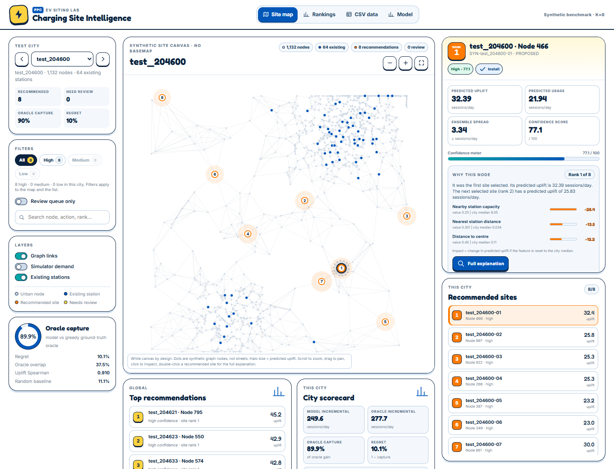
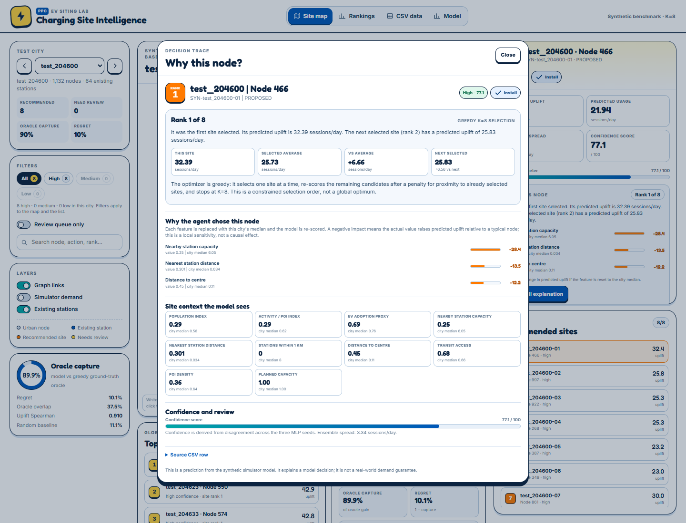
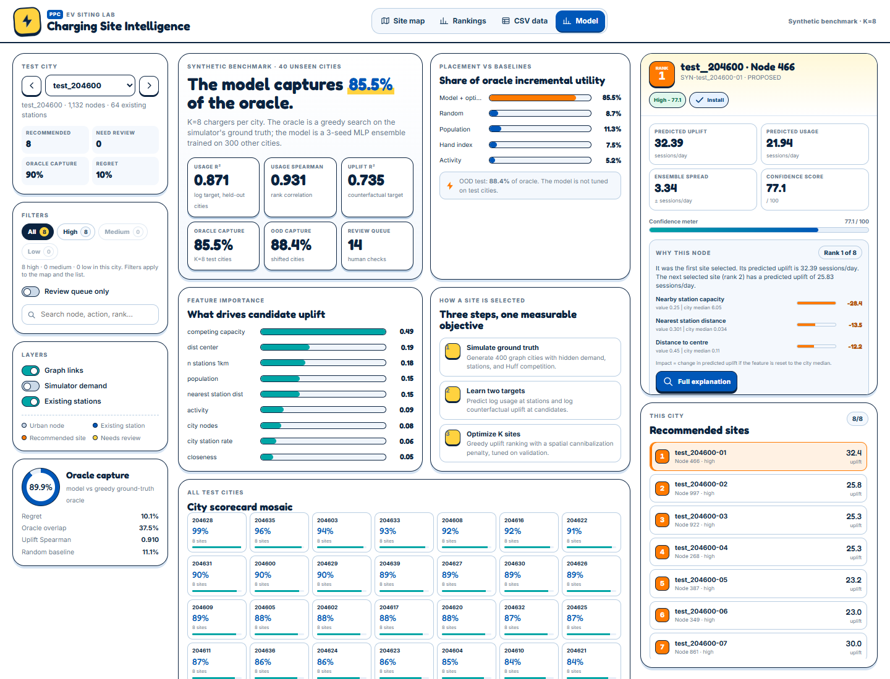

# PPC EV Siting Lab

A standalone, white-canvas decision-support UI for the **synthetic EV charging placement benchmark**. It turns the benchmark's 320 agent recommendations into a ranked map and site-inspection workflow: each recommendation shows predicted uplift, confidence, uncertainty, a local explanation, and the exact source CSV row.

The central question is **why this node?** A full decision trace shows where the site ranked in the K=8 selection, how its prediction compares with the other selected sites, which model inputs drove the score, and what the model saw at that location.

The visual language combines PPC's clean energy palette (navy, blue, teal, orange) with a bold, card-based editorial style: strong outlines, offset shadows, clear rank badges, warm accent colour, and compact data panels. No game assets or game terminology are used.







## Why the map is blank white

The city is a synthetic graph. There is **no basemap, no streets, and no imagery** on purpose: a real map would imply that the normalized node coordinates are geographic, and the city outline would distract from the node positions. The canvas shows only:

- small grey dots = synthetic urban nodes;
- faint links = graph edges;
- blue dots = existing stations;
- orange/amber dots with rank numbers = recommended new sites.

Everything is drawn on white so the recommendation pattern is the only thing that matters.

## Features

### Site map
- Pure white canvas, no tile layer.
- Pan, wheel zoom (anchored under the cursor), fit-to-city, zoom buttons.
- Recommended sites carry a soft halo scaled by predicted uplift, so the strongest candidates stand out before opening anything.
- **Double-click a recommended site** to open its decision trace; double-click empty canvas to fit the city.
- Existing stations, recommendation ranks, review flags, optional graph links, optional simulator-demand layer.
- Hover tooltip shows rank, uplift, confidence, and the top local driver; click to inspect.
- Abstract coordinates are labelled as such.

### Filters
- Confidence chips (**All / High / Medium / Low**) show the per-city counts, so a city where every site is high-confidence is obvious at a glance.
- Filters apply everywhere: map markers, the recommended-sites list, and the details panel. If the selected site is filtered out, the selection moves to the first visible site (or clears with an explanation).
- Review-queue-only toggle and text search (search narrows the list only).
- The map KPI switches to "N of 8 sites shown" while a filter is active.

### Site inspection
Select any recommended node (or a row) to see:
- rank badge and action ID;
- **confidence level and 0–100 confidence score**;
- predicted uplift, predicted usage, ensemble spread;
- review reason if the action needs human review;
- a compact **Why this node** summary with rank, comparison with the next selected site, and the top three drivers;
- the **actual `priority_sites.csv` row**;
- copy row, jump to the CSV view, open the full decision trace, or open the row in Rankings.

Selecting an existing station or a plain candidate node also works; the panel explains what that node is and points to the nearest recommendation.

### Decision trace
Open it by double-clicking a recommended node or using **Full explanation** in the details panel. It shows:
- **Selection position** — rank X of 8 in this city, and whether it was the first, middle, or last pick.
- **Comparison** — predicted uplift for this site, the selected-site average, the difference, and the next selected site.
- **Local drivers** — occlusion impacts for the top features, with the actual value and the city median. A negative impact means resetting that feature to the median would lower the prediction; it is a model sensitivity, not a causal effect.
- **Site context** — population, activity, EV adoption, nearby station capacity, nearest-station distance, station count within 1 km, distance to centre, transit access, POI density, and planned capacity, each with a city median.
- **Confidence** — score, three-seed ensemble spread, and the review reason if applicable.
- **Source CSV row** — the exact artifact row, collapsed behind a details control.

This is the answer to “why did the agent choose that node?” without leaving the map.

### City controls
- 40 test cities.
- Confidence filter (all/high/medium/low).
- Review-queue-only filter.
- Search by node, action, rank, or confidence.
- City scorecard: oracle capture, regret, oracle overlap, Spearman, baseline.

### Rankings
- All 320 recommendations ranked by predicted incremental sessions/day.
- Confidence and review filters, search.
- Select any row to jump to the node on the map.
- Opening a site from the map via the **Rankings** button in the details panel scrolls to its row and highlights it.

### CSV data
- The exact `priority_sites.csv` data, all 16 columns, horizontally scrollable.
- Search across the raw row.
- Select a row to inspect the node.
- Download the original CSV.

### Model view
- Headline metrics: usage R², Spearman, uplift R², oracle capture, OOD capture, review count.
- Model vs random/population/hand-index/activity baseline bars.
- Permutation feature-importance bars.
- “How a site is selected” three-step explainer.
- 40-city scorecard mosaic.
- Scope note: synthetic benchmark, not a real Romanian demand forecast.

### Interaction
- Click a node to inspect it; double-click a recommended node to open its decision trace.
- Keyboard: `←`/`→` cycle recommendations, `Esc` closes the trace or clears the selection, `F` fits the map.
- URL hash preserves city/node/view state.
- Responsive layout; mobile puts the map first.

## Run

From the repository root:

```powershell
cd frontend
..\ML-Agent\.venv\Scripts\python.exe server.py
```

The server prints a URL (default `http://127.0.0.1:8000/`, auto-increments if busy) and opens it. No build step, no npm, no extra Python dependencies.

### UI checks and previews

With the server running:

```powershell
cd frontend
..\ML-Agent\.venv\Scripts\python.exe tools\ui_check.py      # headless Edge + Playwright assertions
..\ML-Agent\.venv\Scripts\python.exe tools\make_previews.py # regenerate preview*.png
```

`ui_check.py` asserts the zoom limits, filter/map/list/details consistency, the
double-click-to-decision-trace flow, driver values, and the rank-digit typography.

### Rebuild the demo data

The frontend reads a generated bundle, not the 261 MB `cities.joblib` directly:

```powershell
cd frontend
..\ML-Agent\.venv\Scripts\python.exe tools\build_data.py
```

It reads:

- `data-generation/data/synthetic/cities.joblib`
- `ML-Agent/outputs/synthetic/priority_sites.csv`
- `ML-Agent/outputs/synthetic/placement_results.csv`
- `ML-Agent/outputs/synthetic/review_queue.csv`
- `ML-Agent/outputs/synthetic/metrics.json`
- `ML-Agent/outputs/synthetic/feature_importance.csv`
- `ML-Agent/outputs/synthetic/agent_state.json`
- `data-generation/data/synthetic/benchmark.json`

and writes `data/dashboard.json` (40 cities, 320 recommendations, ~4 MB) plus copies of the human-readable CSV/JSON artifacts.

## Files

```text
frontend/
├── index.html              # app shell and inline SVG icon sprite
├── styles.css              # white-canvas editorial/utility theme
├── app.js                  # canvas map, state, details, tables
├── server.py               # dependency-free static server
├── data/                   # generated bundle + copied CSV/JSON artifacts
├── tools/build_data.py     # artifacts → UI JSON
├── tools/ui_check.py       # headless UI regression checks
├── tools/make_previews.py  # regenerate the screenshots below
├── preview.png             # site map view
├── preview-why.png         # decision trace
├── preview-leaderboard.png
├── preview-csv.png
├── preview-model.png
└── preview-mobile.png
```

## Design notes

- **White canvas, no basemap.** A deliberate data-literacy choice.
- **Site cards, not pins.** A recommendation is a decision unit: rank, value, confidence, risk.
- **Every recommendation has a reason.** The map and details give the short version; the decision trace gives the selection position, comparable values, feature values, city medians, and confidence.
- **Explanations are sensitivity, not causality.** Occlusion impacts describe what the model would predict if one input were reset to the city median; they do not prove that changing the real world would cause that outcome.
- **Confidence is not a probability.** It is derived from disagreement across the three MLP seeds; the meter explains this.
- **The CSV is first-class.** The UI never hides the underlying artifact; the exact row is shown on selection.
- **Model view is separate.** The map is the product; the model tab documents the evidence and caveats.
- **No external map or chart library.** Canvas 2D and hand-built SVG/CSS keep the demo portable and offline-friendly (Google Fonts degrade gracefully to system fonts).

## Limitations

- The benchmark is synthetic; absolute sessions/day are simulator quantities.
- Confidence is a heuristic triage signal, not a calibrated interval.
- The map is not geographic; normalized coordinates are not lon/lat.
- The UI displays the existing `priority_sites.csv`; it does not retrain or re-run the agent in the browser.
- The page needs a local HTTP server for `fetch()`; opening `index.html` directly from disk will not load the JSON bundle.
